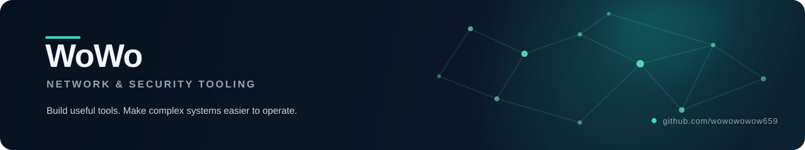

  

  **Network operations · Security tooling · Practical software**

  
  
  
  
  

## About

I build practical tools that make networks easier to observe, understand, and operate.

My focus sits at the intersection of **network engineering, Linux, security testing, and AI-assisted development**. I care about the gap between raw command output and the clear, operator-friendly workflow needed to turn that output into a decision.

## Selected work

### LAN Scanner

A local-network asset discovery toolkit with live scan feedback, service screenshots, and exportable reports.

- Next.js, React, and TypeScript operator interface
- Node.js API with Server-Sent Events for live logs
- Network discovery through `fscan`
- Automated service capture with Puppeteer
- Searchable results, scan history, and HTML / JSON export

<!-- Add the public repository link after the security review is complete. -->

## Current focus

- Building network visibility and troubleshooting workflows
- Exploring AI-assisted tooling with explicit operational boundaries
- Documenting authorized security labs and reproducible experiments
- Turning repetitive infrastructure tasks into small, understandable tools

## Toolbox

| Area | Tools and concepts |
|---|---|
| Networking | TCP/IP, VLAN, static routing, RIP, VRRP, Layer 3 switching, interface and routing-table troubleshooting |
| Systems | Windows, Linux, Kali, virtual machines, command-line diagnostics |
| Development | TypeScript, React, Next.js, Node.js, SSE, Puppeteer |
| Security | Wireshark, Burp Suite, controlled web-security labs |

---

  Small tools. Clear operational value.

